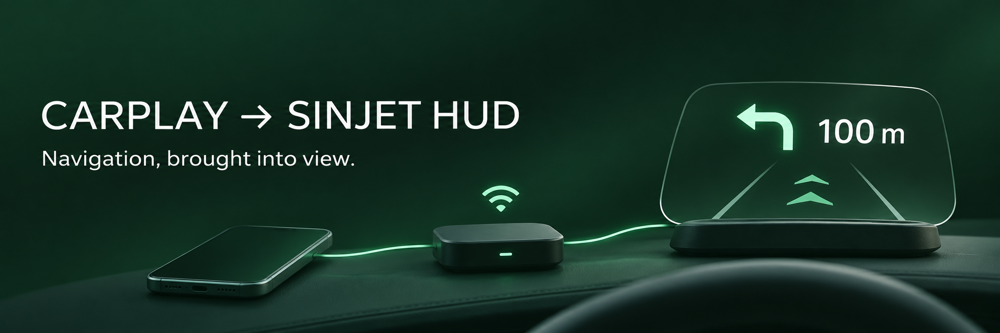
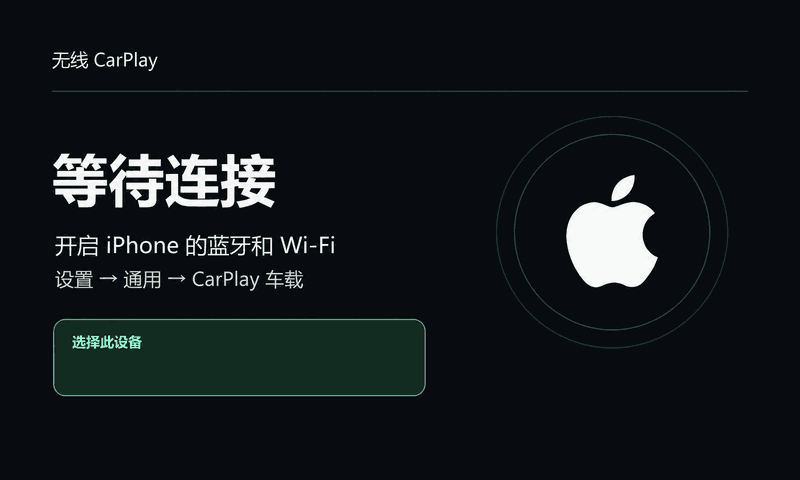

# CarPlay → Sinjet HUD

**让熟悉的 HUD，接上你的 CarPlay 导航。**

转向 · 距离 · 道路文字 · 车道引导

[开始使用](docs/README.md)　·　[选择版本](docs/versions.md)　·　[图标补全](docs/hud-upgrade.md)　·　[参考与致谢](docs/references.md)

GPT 生成的项目概念封面；实际适配型号与验证状态见下表。

---

用兼容的无线 CarPlay 盒子接收结构化导航，再通过蓝牙把转向、动作距离、单行文字与车道引导显示在信界 HUD 上。仓库包含转换核心、U5/U6A 适配、管理网页、诊断和 HUD 图标补全工具。

## 选一条适合你的路线

<table>
<tr>
<td width="50%" valign="top">
<h3>① 简单方式</h3>

<strong>只刷盒子，HUD 保留原厂固件。</strong>

先打通导航显示。使用兼容图标表，适合第一次尝试或希望少改硬件的车友。

<a href="docs/quick-start.md"><strong>查看逐步教程 →</strong></a>

</td>
<td width="50%" valign="top">
<h3>② 进阶方式</h3>

<strong>为对应型号的 HUD 补全转向图标。</strong>

在简单方式正常运行后，核对模块与底包，完成专用图标补丁并开启完整图标模式。

<a href="docs/hud-upgrade.md"><strong>查看补图与验证 →</strong></a>

</td>
</tr>
</table>

## 先认型号，再选版本

| 设备 | 必须匹配的标识 | 本次版本 | 状态 |
| :--- | :--- | :--- | :--- |
| **U6A 盒子** | `ly8952` · `26052617.8952.1` | **R2c · 当前主版本** | 自动连接修复，离线检查通过；实机自动连接待确认 |
| U6A 回退参考 | 同上 | R2a | 搜索、连接与导航显示有短时实机反馈；有后续自动连接问题反馈 |
| U5 盒子 | `ly2734` · `26051317.2734.2` | R18 | 前代功能有实机反馈；R18 排序逻辑有离线验证 |
| **信界 FB0** | `HUDBAFB0` | **201013 R1** | 内部 `20201013`；实体刷写与显示待反馈 |
| 信界 SA0 | `HUDBASA0` | 230928 R3 | 三主题补图已有显示反馈；不适用于 FB0 |

> **版本说明**：R2c 是本次选用的 U6A 主版本，主版本不等于所有场景已经实测。R2b 已停用。不同项目号或 HUD 模块号的完整程序不能互刷。

首发提供源码、教程、图标和构建工具。先看[版本选择](docs/versions.md)，按型号找到版本说明和构建入口。已有候选固件的用户可以核对[文件名与 SHA-256 清单](releases/manifest.json)。

## 接通后能做什么

| 导航显示 | 连接与维护 |
| :--- | :--- |
| 当前动作与下一次转向距离 | 保存 HUD 设备与自动转发开关 |
| 动作描述优先，兼顾前方与当前道路 | CarPlay 就绪后由后台恢复连接 |
| 按车道编号排序，最多显示六条 | 蓝牙断链诊断与重连处理 |
| 兼容图标表与完整图标表切换 | 诊断记录与正常导航独立运行 |

<strong>查看显示规则与已知边界</strong>

- 当前动作由路线中的动作索引决定，不把 Apple 地图后续左转提前显示为当前动作。
- 单行文字依次选择动作描述、`前方：下一道路`、`当前：当前道路`，不从描述里强行截取道路名。
- 超过六条车道时选择连续六条并优先覆盖推荐车道；车道标志不等于收到完整车道组。
- 有效导航约每秒重发显示；快速更新采用最新状态。显示刷新不等于地图每秒一定发送新数据。
- 关闭诊断日志不应影响导航、设置恢复或自动连接。实验性的蓝牙心跳开关已移除。
- 蓝牙超时断链曾出现，快速重连改善体验不等于根因全部解决。

## 盒子界面一览

等待连接界面资源；设备名等动态内容由盒子实际状态决定。

## 按你关心的内容继续

| 我想…… | 从这里开始 |
| :--- | :--- |
| 让自己的 HUD 先显示导航 | [教程入口](docs/README.md) · [简单方式](docs/quick-start.md) |
| 为 FB0 补齐转向图标 | [HUD 补图](docs/hud-upgrade.md) · [扩展编号](src/hud-icons-r3/icon_ids.h) |
| 看懂结构化导航与转换 | [架构说明](docs/architecture.md) · [源码索引](src/README.md) |
| 编译、测试或适配其他型号 | [构建说明](docs/build.md) · [验证范围](docs/validation.md) |
| 自建下载站、配置 QX | [配置教程](docs/hosting.md) · [示例配置](examples/upgrade.json) |
| 报告问题或贡献改进 | [常见问题](docs/troubleshooting.md) · [贡献说明](CONTRIBUTING.md) |

## 参考、署名与许可

感谢 **LuKa / mib2q-carplay-rgi** 的路线引导解析工作，以及研究中参考的 **KidMixer / mazda-carplay-hud**、**ludwig-v**、**node-CarPlay**、**DiPlay** 和 **Srysfu 的刷写工具**。

[参考项目与致谢](docs/references.md) 按“实际复用 / 研究参考 / 工具”说明各自作用；复用代码保留原版权、固定提交与许可证，不能用一句“感谢”替代许可义务。完整固件包含厂商组件，公开附件前需确认其再分发许可；源码的 GPL 声明不覆盖原厂程序与图像。

**[GPL-3.0-or-later](LICENSE)** · [第三方声明](THIRD_PARTY_NOTICES.md) · [隐私与反馈](SECURITY.md)

独立适配项目，非 Apple、信界或盒子厂商的官方产品。公开问题反馈前请删除行程与设备标识。
