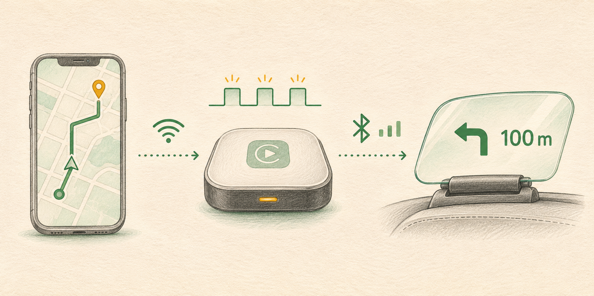

# 架构与调度

手机地图 → CarPlay/iAP2 结构化消息 → 盒子接收与会话代次 → 独立导航共享通道 → 公共转换核心 → BLE 服务 → 信界 HUD。

0x5201 为路线状态与当前动作等信息，0x5202 为动作详情，0x5204 为车道组。代码分别缓存并合并增量消息，不能用一条消息缺失某字段推断上游永远不支持它。

`src/ble-r18/core` 负责解析、当前动作选择、文字优先级、车道排序和两套图标映射。`core_adapter.c` 连接核心与各平台。`iap_patch` 是 U5 入口，U6A 当前入口在 `u6a-8952-r2c`。

`u6hud_ble.c` 的后台恢复与连接不依赖网页常开，不依赖收到下一条转向。CarPlay 会话就绪核验保留认证、进程存活和实际可执行文件路径；不能依赖会被线程改写的短名称。

诊断共享区与转发通道独立。日志开关只控制可选记录，导航数据和自动恢复继续工作。蓝牙写成功仅说明传输层结果，实际图案仍要核对 HUD 固件和主题。
