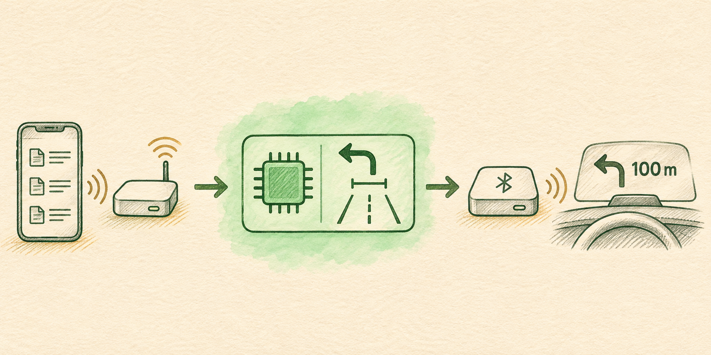

# 其他品牌的无线 CarPlay 盒子怎么适配

[教程入口](README.md) · [路先行下载与刷写](luxianxing-flashing.md) · [源码索引](../src/README.md)

图中央的**导航转换核心**可以先在电脑上跑通。左右画的是同一台盒子的两端，左边接收 **CarPlay 路引**，右边用 **BLE** 发给 HUD。换盒子后，这两处接口需要分别验证。

[下载盒子适配资料包](https://github.com/Ech35/CarPlay-Sinjet-HUD/releases/download/v0.1.1/CarPlay-Sinjet-HUD-Box-Porting-Kit.zip)，解压后从本页和设备记录模板开始。

## 先确认新盒子具备哪些条件

| 先查什么 | 到哪里核对 | 需要得到的结果 |
| :--- | :--- | :--- |
| 品牌、型号、硬件修订、实际运行版本 | 盒身、配置页、厂商资料 | 能明确区别同名或换壳批次 |
| 原厂镜像与恢复方式 | 厂商提供的下载及恢复文档 | 有同一设备的原厂包和可执行的恢复流程 |
| 处理器、位宽、系统、运行库 | 原厂文档、可合法检查的固件或开发接口 | 能编译并运行匹配目标的程序 |
| 结构化导航事件 | 平台 SDK、车载集成接口或经授权的本机开发接口 | 能接收当前导航状态、动作、距离；车道按实际输出核对 |
| BLE 主机能力 | 平台文档与本机开发测试 | CarPlay 正常连接时，盒子能发现 HUD、建连并写入 |

从一份[设备与验证记录模板](../examples/box-porting/device-profile.md)开始。先记录原厂状态，才能确认问题来自哪一段。若设备只能提供画面与音频，当前转换层缺少可用的结构化输入。

## 第一步 · 先在电脑上回放

1. 从[构建工具容器](toolkit.md)运行现有离线测试，或按[本机验证](build.md#公共核心)编译并运行。测试用合成输入，覆盖转向、距离、优先文字、车道排序、兼容图标和清屏。
2. 查看[公共转换源码](../src/ble-r18/core/hud_core.c)与[接口头文件](../src/ble-r18/core/hud_core.h)。[现有平台适配接口](../src/ble-r18/core_adapter.h)说明如何送入导航事件、处理会话结束和恢复显示。
3. 记录样例中的输入与预期输出。新平台若提供结构化对象或另一种编码，先写本地输入适配，经合成消息验证时间、单位、动作索引和车道顺序。现有核心使用本项目的 iAP2 路引输入，接入其他来源需要映射，不能把任意格式的报文直接送入。

## 第二步 · 独立接通两端

| 部分 | 可参照的文件 | 新品牌要确认什么 |
| :--- | :--- | :--- |
| 导航入口与会话 | [U5 平台目录](../src/iap_patch) · [U6A 平台目录](../src/u6a-8952-r2c) · [架构说明](architecture.md) | CarPlay 就绪后从设备支持的接口取得路引。确认正式导航开始和停止时的状态变化 |
| 导航处理 | [公共核心](../src/ble-r18/core) · [合成回放](../src/ble-r18/test_adapter.py) | 用同次会话的路线、动作和车道更新组合当前画面。距离、当前动作与结束事件分别验证 |
| BLE 转发 | [U5 连接与后台示例](../src/ble-r18) · [U6A HUD 后台](../src/u6a-8952-r2c/u6hud_ble.c) | 走平台正式 BLE 接口。先测「左转 100 米」和清屏，再测自动连接和断线恢复 |
| HUD 图标 | [扩展编号](../src/hud-icons-r3/icon_ids.h) · [补图与兼容说明](hud-upgrade.md) | 先用兼容模式。新图号仅用于已经刷入对应图标资源的 HUD |

U5 和 U6A 的运行库、启动和封包有各自的约束。新设备沿用自己的打包、更新与恢复流程。同一项目号也需要核对底包指纹，已发布的 IMG 只用于下载表对应设备。

## 第三步 · 验证再集成

在停车或台架环境按顺序验证原厂 CarPlay、路引接收、固定画面、真实导航、结束清屏、重连与上电自动连接。把每阶段的预期和实际结果填进记录模板。先确认业务路径正常，再打开可选诊断核对计数，最后确认关闭诊断后仍可正常导航。

若盒子属于同种 CPBox SWU 布局，可用[只读镜像检查工具](../tools/inspect_cpbox.py)确认 `ly_project_name` 和完整镜像 SHA‑256。出现不支持的包格式，应依据该厂商文档改用匹配工具。待选择具体第三方型号并完成台架检查后，再记录适配结论。
