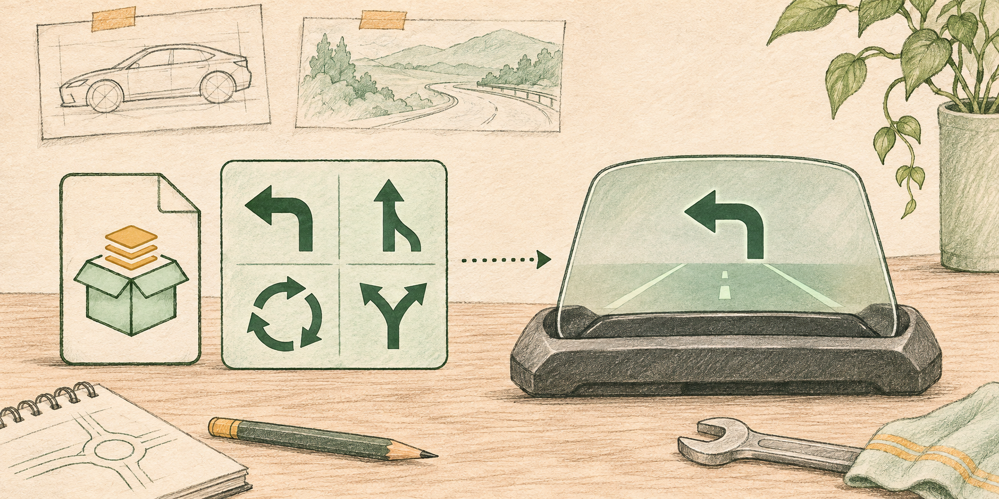

# 进阶方式：HUD 补图

盒子发的是动作编号，HUD 用该编号调用自己的图片资源。补图把缺少的资源加到对应型号的 HUD，之后再在盒子上开启「完整转向图标」。

先在配套助手的“关于 / 模块”读取完整模块号；必要时按既有方法连续点击版本打开模块信息。记录当前版本。不能根据车型名称选择完整程序。

HUDBAFB0 使用本仓库 FB0 专用代码和 201012 原厂底包。程序地址、布局、逻辑资源编号与 BASA0 不同；不能直接刷 BASA0 的 PAK。

FB0 的 46 个扩展槽位对应 BLE 40–85；逻辑资源为 0x4000–0x402D。四种仪表主题共享一套 68×68 导航图。环岛第 1–19 出口为预先合成的整图。

图标清单有 138 条三主题槽位，其中 131 张是项目新图，另外七个槽位复用原厂图。公开 PNG 目录只保存新图；复用槽位在构建时从用户提供的原厂包读取。

FB0 升级后先确认开机、版本、车速与车辆信息，再测 40、45、46、49、50、51、55、61、68、76、85，最后逐个测完整范围。每次确认显示及清屏。通过后在盒子开启“完整转向图标”。

已完成的离线 Thumb 校验不覆盖真实 Bootloader 刷写、PNG 硬件渲染、掉电恢复和车辆 CAN 功能。FB0 当前仍待实机反馈。

自建下载站与 QX 配置见 [对应说明](hosting.md)。本仓库不提供厂商固件服务器地址或作者私人站点。
