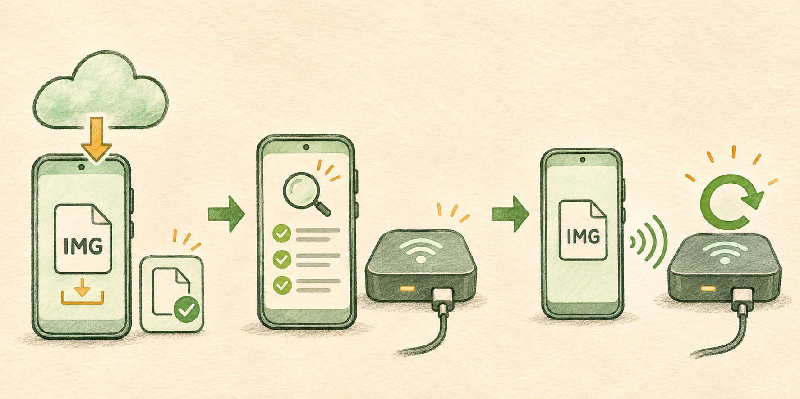

# 路先行无线 CarPlay 盒子下载与刷写

[教程入口](README.md) · [改装固件下载](versions.md) · [其他品牌盒子适配](box-porting.md)



图中从左到右依次是取得并保存原厂固件、核对本地 IMG、连接盒子完成刷写。实际按钮名称和操作见下文。

## 确认盒子品牌和项目号

本项目发布的盒子镜像以路先行 CPBox 系列的下列两个设备为目标。先看盒身标签和管理页，再核对完整版本。相同外壳或销售名称可能来自不同批次。

| 品牌与型号 | 项目号 | 本项目适配的原厂底包 | 改装固件 |
| :--- | :--- | :--- | :--- |
| 路先行 U5 | `2734 / ly2734` | `26051317.2734.2` | R18 |
| 路先行 U6A | `8952 / ly8952` | `26052617.8952.1` | R2c |

例如 `26052617.8952.1` 中间的 `8952` 是项目号。连接盒子后可在 Android 工具顶部查看项目号，也可以点「查询盒子」刷新。完整版本以盒子管理页或设备返回的 appver 为准。

## 取得刷写工具

在 Android 手机上从 [Srysfu 的 Luxianxing-Firmware-Tool Releases](https://github.com/Srysfu/Luxianxing-Firmware-Tool/releases) 下载 APK。本教程对应 [v1.3.0](https://github.com/Srysfu/Luxianxing-Firmware-Tool/releases/tag/v1.3.0)，有自动读取项目号和按项目号分类的功能。下载、校验、刷写功能和源码都可在[原项目](https://github.com/Srysfu/Luxianxing-Firmware-Tool)核对。

## 下载并保留原厂 IMG

1. 先记录当前完整版本。让 Android 手机能上网，打开路先行固件工具。
2. 点「抓取服务器固件」，选择实际项目号 `2734` 或 `8952`。输入框填好项目号时可直接查询，留空时从分类选择。
3. 选与你的盒子匹配的完整版本。原厂恢复优先保留设备当前使用的同版本官方包。复现本项目时选择上表指定的底包。列表有正式版和测试版，遇到版本缺失时应向供应商取得该设备的原厂包。
4. 下载后工具自动检测。文件位于 Android 共享的 **Download** 目录，文件名形如 `cpbox_26052617.8952.1_<时间戳>.img`。在「文件」App 的「下载」中找到它，另存一份原始文件并记录版本。

本项目构建用到的两份原厂 IMG 指纹如下。它们来自对应底包，与改装成品的哈希不同。

| 原厂底包 | SHA-256 |
| :--- | :--- |
| `2734 / 26051317.2734.2` | `e2766acc8df294c178ab077f52a955f8d521845fb8a446d98df9ccc4bc4c9538` |
| `8952 / 26052617.8952.1` | `172a455fed34347fd7fdb4d4758733a9986c02b5e811c80f9decb655e45c5ffa` |

## 用本地固件刷写

1. 从[版本与下载](versions.md)保存对应改装 IMG，按 [SHA‑256 清单](../releases/manifest.json)核对。要恢复原厂时，改选先前保存的匹配原厂 IMG。
2. 盒子接车机 USB 并维持稳定供电。首次刷写在停车时操作。连接盒子的 Wi‑Fi 热点，确认可打开默认管理地址 `http://192.168.1.101`。下载时如果手机需要互联网，可先下载，再切回盒子热点刷写。
3. 打开工具，查询盒子项目号，选择本地 IMG 并检查。核对三个值：盒子实际项目号、IMG 内的 `ly_project_name`、发布页的项目号。需要在电脑上核对包内项目号时，运行下面的只读脚本。
4. 确认文件和设备相符、校验通过后，点工具的刷入按钮。等待工具显示成功并让盒子完成重启。途中保持供电和热点连接。上传完成、盒子接受升级、重启完成是三个阶段。
5. 重启后打开盒子网页核对版本和 HUD 桥接页面。先连 CarPlay，再按[首次连接和显示测试](quick-start.md)验证 HUD。

U6A R2c 用 Android 工具刷写。它的管理页没有本地固件上传入口。

### 为什么项目号检测可能报红

v1.3.0 顶部显示的项目号来自盒子 appver。固件检测里的旧判定却把 `ly2872` 写死在解析器里，所以 `ly2734` 或 `ly8952` 的正确镜像也可能出现「缺少 ly2872」。请根据实际设备、镜像项目号和发布指纹核对。如果项目号确实不符，或 MD5、CPIO、包头等其他检查报错，应停止并重新核对文件。

如果只有这条提示，且实际项目号、底包版本、镜像 SHA‑256 与对应发布清单一致，就按该型号的本地刷写流程继续。

实现依据见[原解析器](https://github.com/Srysfu/Luxianxing-Firmware-Tool/blob/v1.3.0/app/src/main/java/com/boxflasher/tool/FirmwareParser.kt)和[原检测器](https://github.com/Srysfu/Luxianxing-Firmware-Tool/blob/v1.3.0/app/src/main/java/com/boxflasher/tool/FirmwareChecker.kt)。

在仓库根目录运行以下命令。把路径换成实际下载位置，U5 使用 `ly2734`。

```powershell
python -m pip install PySquashfsImage
python tools/inspect_cpbox.py inputs/u6a-stock.img --expect-project ly8952
```

脚本输出项目号、完整镜像 SHA‑256，以及 SWU 外层 MD5 和 CRC CPIO 检查结果。版本仍需对照下载记录、设备 appver 和已知 SHA‑256。格式不符会报错，镜像内容保持原样。
