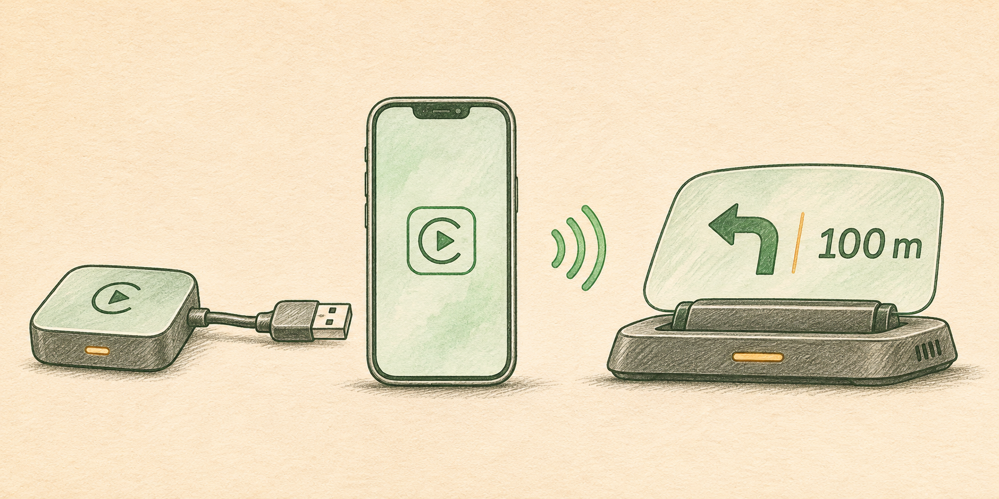

# 简单方式 · 只刷盒子

[项目首页](../README.md) / [教程入口](README.md) / 简单方式

**目标：HUD 继续使用原厂固件，也能显示 CarPlay 导航。**

图中是本教程涉及的三件设备。盒子接在车机侧，iPhone 连 CarPlay，信界 HUD 由盒子通过蓝牙连接。

| 需要准备 | 说明 |
| :--- | :--- |
| 对应型号的盒子 | U5 / 2734，或 U6A / 8952，核对底包版本 |
| 可正常工作的信界 HUD | 确认能开机，先记录模块号 |
| 对应镜像与刷写工具 | 从版本清单核对文件，工具使用路先行原项目发布版本 |
| 一次停车测试 | 首次设置、固定显示和日志导出在停车时完成 |

## 01 · 选对文件

1. 记录盒子项目号和底包。U5 是 `2734 / 26051317.2734.2`；U6A 是 `8952 / 26052617.8952.1`。
2. 打开 [版本选择](versions.md)，选择与自己设备一致的镜像。本次 U6A 采用 **R2c**，实机自动连接效果仍待反馈。
3. 已取得成品时，对照[文件清单](../releases/manifest.json)核对文件名、字节数与 SHA-256。还没有成品的 U6A 用户可以从对应原厂底包[本地构建 R2c](build.md#u6a-r2c)。

> **本阶段完成标志**：知道自己对应哪个项目号，选到的是同项目、同底包的文件。

## 02 · 刷入盒子

使用 [路先行固件工具原项目](https://github.com/Srysfu/Luxianxing-Firmware-Tool) 发布的 APK，按照它的连接与本地固件刷写说明操作。

U6A 当前管理页已去掉固件升级入口，应沿用此前可用的刷写工具流程。U5 的网页上传说明不能直接当作 U6A 管理页操作步骤。

> **本阶段完成标志**：盒子重启后，手机与车机能正常进入 CarPlay。

## 03 · 第一次连接 HUD

1. 停车后，先让 iPhone 正常连接 CarPlay。
2. 打开盒子管理地址 `http://192.168.1.101`，进入 **HUD 桥接**。
3. 关闭其他手机助手与 HUD 的连接，保持 **自动转发导航关闭**。
4. 点击 **搜索 HUD → 选择自己的设备 → 连接 HUD**。
5. 发送 **左转 100 米** 和 **六车道显示** 测试，观察图标、距离、车道以及约三秒后的清屏。

> **本阶段完成标志**：固定测试能正确显示并清屏。成功前先不要急着开启自动转发。

## 04 · 开始真实导航

1. 保持 **完整转向图标关闭**，开启 **自动转发导航**。
2. 在地图里选择路线并点击“出发 / 开始导航”。路线预览不等于正式逐向导航。
3. 核对 HUD 上的转向、距离和文字；经过路口时观察是否切换到下一动作。
4. 结束导航后，确认 HUD 正常清屏。

> **本阶段完成标志**：正式导航能显示，结束后能清屏。之后再考虑 [HUD 图标补全](hud-upgrade.md)。

示例上半部是**下一次动作和距离**，下半部展示推荐车道。车道是否出现、出现几条，取决于地图当前发送的路引和 HUD 的显示能力。

## U6A R2c · 再测一次自动连接

给盒子和 HUD 重新上电，这次先不打开管理网页、不手动连接 HUD。等 CarPlay 连接后开始导航，观察 HUD 能否自动恢复。

若没有自动连接，**先导出日志，再点手动连接**，并注明是断电重启还是仅断开 CarPlay 后重连。开关开启、设备已保存，与当前蓝牙已经连接是不同状态。

<strong>遇到问题时，最有用的记录</strong>

- 盒子项目号、固件版本、HUD 模块号。
- 问题发生在哪一步：搜索、连接、固定测试、自动转发或重新上电。
- 实际屏幕现象和盒子诊断日志。日志在 RAM 中，断电前导出。
- 公开前去掉路线、起终点、坐标、设备名称、MAC/UUID 和密码。

**继续阅读：** [常见问题](troubleshooting.md) · [版本选择](versions.md) · [教程入口](README.md)
